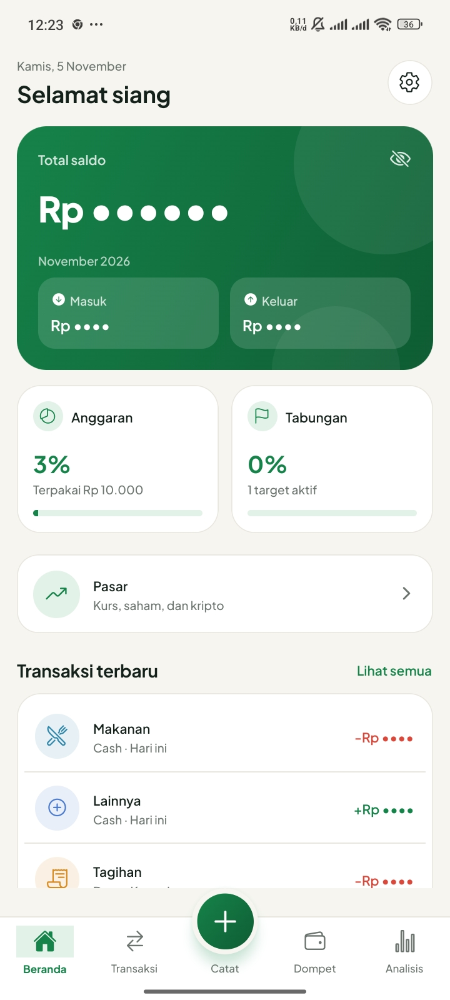
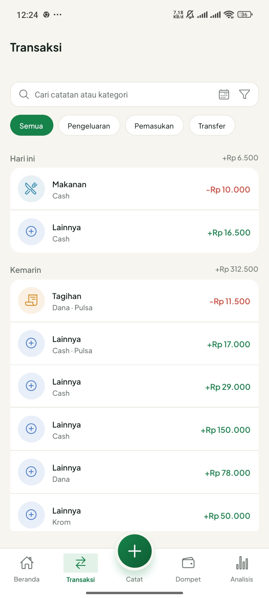
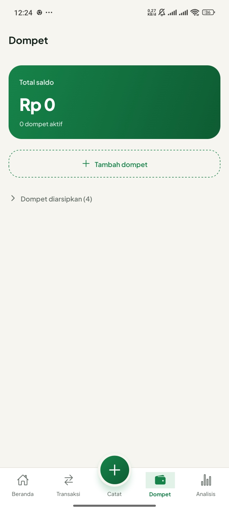
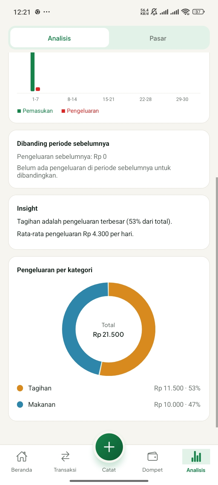
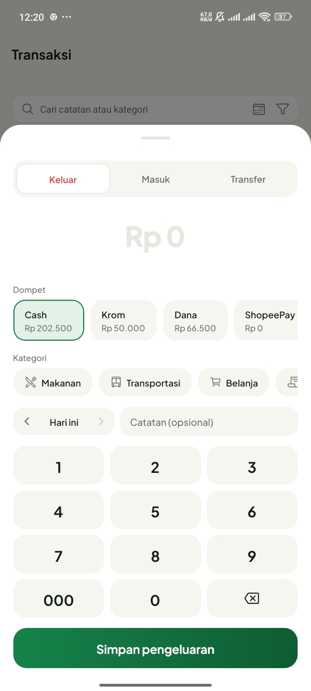
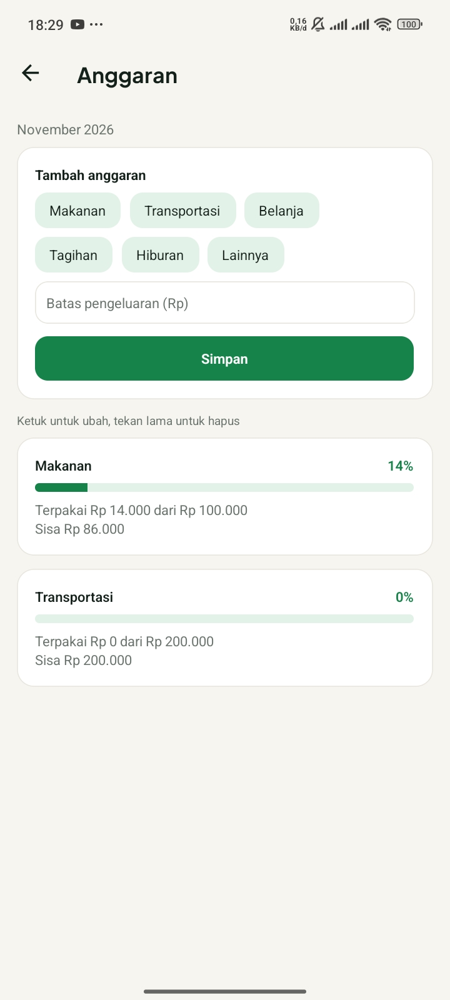

Dompet Simkuring

Catat keuangan pribadi dan kelompok dengan rapi, langsung dari HP.

(https://github.com/fahrisaputra0989-afk/Dompet-Simkuring-releases/releases/latest)

(https://github.com/fahrisaputra0989-afk/Dompet-Simkuring-releases/releases/latest)

---

Tentang

Dompet Simkuring adalah aplikasi Android untuk memudahkan pencatatan transaksi keuangan pribadi maupun kelompok supaya lebih terencana dan tercatat dengan baik. Data disimpan langsung di HP kamu (offline-first), jadi aplikasi tetap bisa dipakai tanpa internet.

Tangkapan layar

<table>
  <tr>
    <td align="center"> Beranda</td>
    <td align="center"> Transaksi</td>
    <td align="center"> Dompet</td>
  </tr>
  <tr>
    <td align="center"> Analisis</td>
    <td align="center"> Anggaran</td>
    <td align="center"> Target tabungan</td>
  </tr>
</table>

Fitur

- Catat transaksi: pemasukan, pengeluaran, dan transfer antar dompet
- Banyak dompet: saldo dihitung otomatis dari riwayat transaksi
- Anggaran: batasi pengeluaran per kategori
- Target tabungan: pantau progres menuju tujuanmu
- Transaksi berulang: catat tagihan atau pemasukan rutin otomatis
- Analisis: grafik, perbandingan periode, dan insight
- Pasar: kurs, saham IDX, dan kripto dengan cache offline
- Keamanan: kunci aplikasi dengan PIN
- Notifikasi: atur pemberitahuan dari aplikasi
- Cadangkan dan pulihkan: simpan data ke file `.db` dan kembalikan kapan saja
- Tampilan: mengikuti mode terang atau gelap HP, plus pilihan warna aksen
- Pembaruan dari dalam aplikasi: tanpa perlu mengunduh ulang manual

Cara pasang

1. Buka halaman [Rilis terbaru](https://github.com/fahrisaputra0989-afk/Dompet-Simkuring-releases/releases/latest) lewat Chrome di HP Android.
2. Di bagian **Assets**, tap **MyWallet.apk** untuk mengunduh (sekitar 31 MB).
3. Buka file yang sudah terunduh (lewat notifikasi unduhan, atau aplikasi File di folder Download).
4. Jika diminta, aktifkan **Izinkan dari sumber ini** untuk Chrome atau File Manager, lalu tap **Pasang**.
5. Jika muncul peringatan Play Protect, pilih **Tetap pasang**. Aplikasi ini dibagikan di luar Play Store.
6. Buka **Dompet Simkuring** dari layar utama. Selesai!

Catatan: aplikasi ini untuk HP Android 64-bit (arm64-v8a), yang dipakai hampir semua HP beberapa tahun terakhir.

Memperbarui

Buka aplikasi, masuk ke **Tentang**, lalu tap **Cek pembaruan**. Ikuti layar pemasangan Android, dan data kamu tetap ada.

Tips: cadangkan data lewat menu Pengaturan sebelum menghapus aplikasi, karena menghapus aplikasi ikut menghapus datanya.

Rencana

- Dukungan mata uang lain (misalnya MYR, SAR, HKD, TWD, KRW, JPY, USD) untuk yang bekerja di luar negeri

Dikembangkan oleh Mufhri · Beginner Developer

[GitHub](https://github.com/fahrisaputra0989-afk) · [Instagram](https://www.instagram.com/mufhri_) · [TikTok](https://www.tiktok.com/@mufhri) · [YouTube](https://youtube.com/@mufhri)

©2026 MuFahri (Muhammad Fahri). Hak Cipta Dilindungi.

